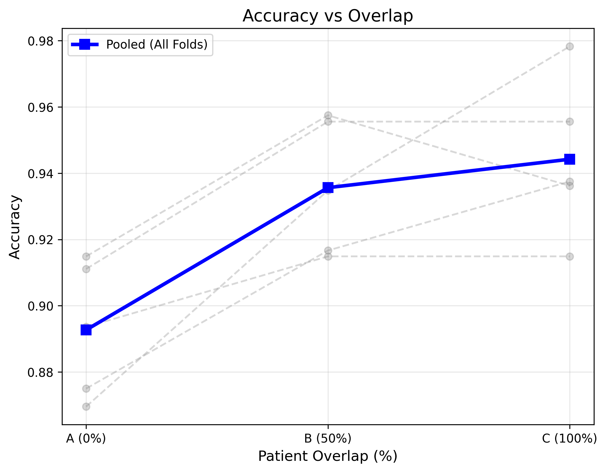
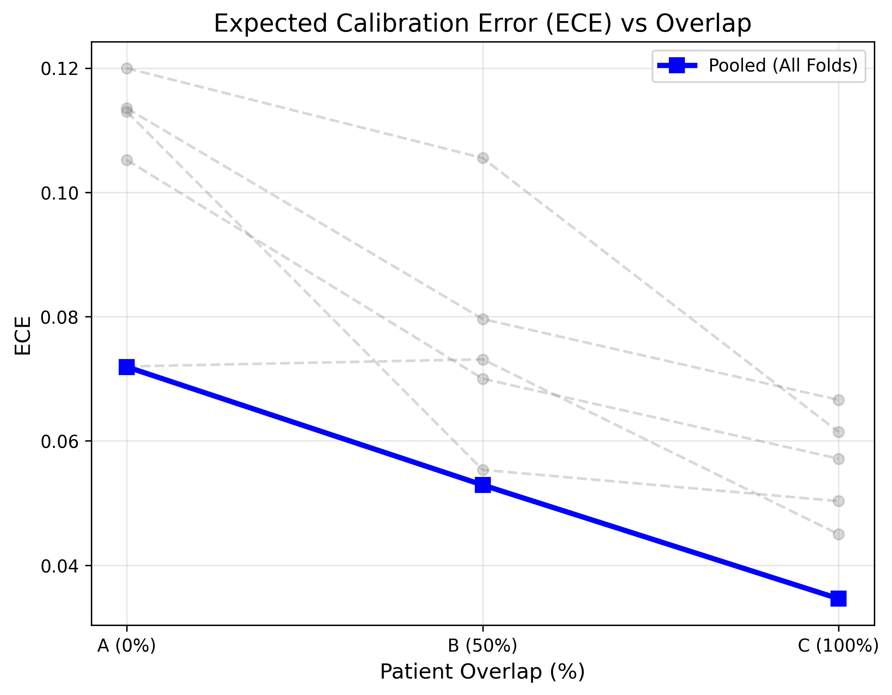
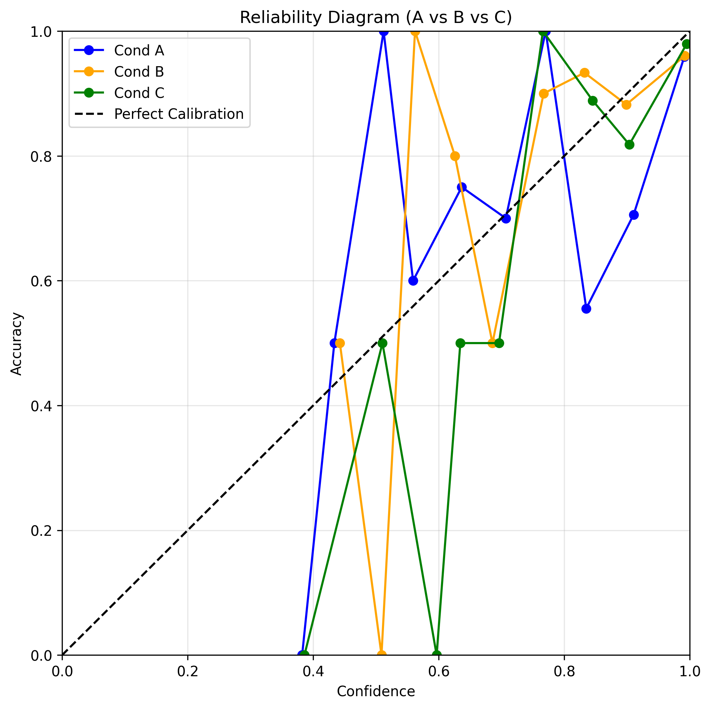

# When Leakage Looks Reliable: Effects of Patient-Level Overlap on Performance, Confidence, and Calibration in Brain Tumor MRI Classification

Sameeksha Sharma · Manuscript in preparation

## 1. Overview
This repository contains the computational pipeline and exploratory results for analyzing data leakage in medical imaging. Specifically, it investigates how failing to properly split MRI data by patient ID (allowing images from the same patient to appear in both training and testing sets) distorts the apparent accuracy and reliability of deep learning models.

## 2. Research Question
"Does patient-level overlap between training and testing data alter not only classification performance but also the apparent reliability and calibration of brain-tumor MRI classifiers?"

## 3. Dataset
The study uses the Cheng et al. Brain Tumor MRI Dataset, comprising 3,064 2D MRI slices from 233 patients. The images are classified into three tumor types: Meningioma, Glioma, and Pituitary.

**Citation:** Cheng J. et al. (2015), "Enhanced Performance of Brain Tumor Classification via Tumor Region Augmentation and Partition", PLoS ONE 10(10): e0140381. https://doi.org/10.1371/journal.pone.0140381

**Dataset:** https://doi.org/10.6084/m9.figshare.1512427

## 4. Dataset Acquisition Instructions
**Note: The raw dataset is NOT included in this repository.**
To reproduce this research, you must acquire the dataset independently:
1. Download the `.mat` file version of the Brain Tumor Dataset by Cheng et al.
2. Place the raw `.mat` files or the extracted archive into `data/raw/` in the root of the project directory.

## 5. Project Structure
- `src/`: Python scripts for data processing, split generation, training, and evaluation.
- `configs/`: Placeholder for external configuration schemas if added.
- `tables/`: Contains all generated split manifests and evaluation CSVs.
- `figures/`: Generated dose-response curves and reliability diagrams.
- `results/`: Root directory for output reports (checkpoints are `.gitignore`d).

## 6. Environment Setup
Create a virtual environment and install dependencies:
```bash
python3 -m venv venv
source venv/bin/activate
pip install -r requirements.txt
```

## 7. Stage 1 — Dataset Verification
Audits the dataset, extracting patient IDs and verifying image integrity across the 233 unique patients, assigning each patient to one of five official outer folds.

## 8. Stage 2 — Pilot Experiment
A rapid Fold-5 pilot experiment verifying the implementation of Apple MPS training, dataloaders, early stopping, and confirming the basic integrity of the classification pipeline.

## 9. Stage 3 — Five-Fold Experiment
The primary experiment uses 5 patient-disjoint outer folds. For each fold, we test three explicit conditions:
- **Condition A (0% overlap)**: Strict patient independence between Train and Test.
- **Condition B (~50% overlap)**: ~50% of eligible test-fold patients have their non-test images added to the training set.
- **Condition C (100% overlap)**: 100% of eligible test-fold patients have their non-test images added to the training set.

**Constraints:**
- One fixed test image per patient.
- Identical validation sets across conditions A/B/C.
- Identical test sets across conditions A/B/C.
- Identical training sizes across conditions A/B/C.
- Model: EfficientNet-B0 (ImageNet init).

## 10. Secondary Analysis
The secondary analysis evaluates the 15 generated models on: Accuracy, Macro F1, Balanced Accuracy, Mean Confidence, Expected Calibration Error (ECE), Brier Score, and High-Confidence Error Rates (HCER).

## 11. Results

Paired comparisons across the five folds; accuracy rose and ECE fell from A to C in all five folds. With five folds, the smallest attainable two-sided Wilcoxon p-value is 0.0625, so results are reported as a consistent direction of effect, not as definitive significance. Full statistics: tables/stage3/statistical_comparison_results.csv.

**Mean across five folds**

| Condition | Accuracy | Macro F1 | Mean Confidence | ECE | Brier | HCER90 |
| :--- | :--- | :--- | :--- | :--- | :--- | :--- |
| **A** | 0.8928 | 0.8941 | 0.9235 | 0.1047 | 0.1812 | 0.0625 |
| **B** | 0.9359 | 0.9369 | 0.9404 | 0.0767 | 0.1172 | 0.0359 |
| **C** | 0.9445 | 0.9432 | 0.9613 | 0.0561 | 0.0842 | 0.0240 |

**Pooled over all 233 test images (one per patient)**

| Condition | Accuracy | Macro F1 | Mean Confidence | ECE | Brier | HCER90 |
| :--- | :--- | :--- | :--- | :--- | :--- | :--- |
| **A** | 0.8927 | 0.8937 | 0.9234 | 0.0719 | 0.1815 | 0.0604 |
| **B** | 0.9356 | 0.9371 | 0.9406 | 0.0529 | 0.1177 | 0.0378 |
| **C** | 0.9442 | 0.9427 | 0.9614 | 0.0346 | 0.0843 | 0.0246 |

**Figures**


*Per-fold and pooled accuracy under zero, partial, and full patient-level overlap.*


*Expected Calibration Error decreases monotonically with overlap across all five folds.*


*Pooled reliability (calibration) diagrams for conditions A, B, and C against the perfect-calibration diagonal.*

## 12. Reproducibility
Trained checkpoints (`*.pt`) are not included in this repository due to size constraints. The exact architectural and hyperparameter configuration used to generate these results is documented in `REPRODUCIBILITY.md`.

## 13. Data Availability
As stated, the raw `.mat` files are excluded from version control. Output tables and summary statistics are provided in `tables/stage3/`.

## 14. License
MIT License. See LICENSE.

## 15. Citation
See `CITATION.cff` for citation metadata formatting.
