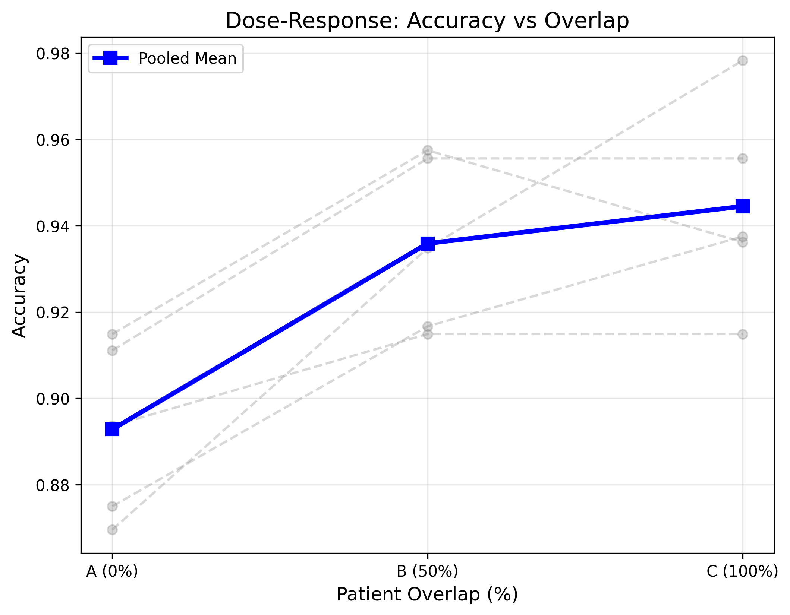
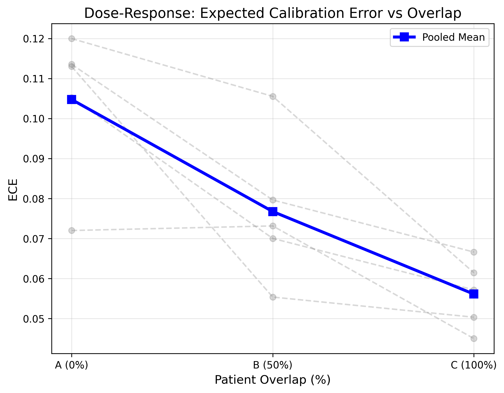
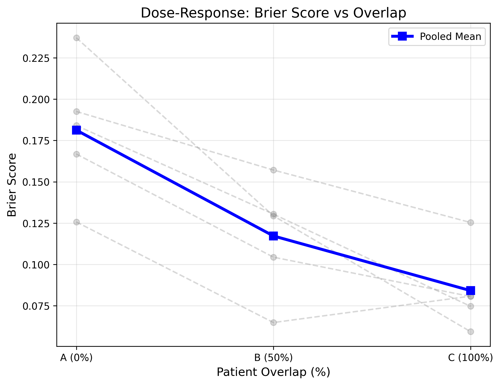
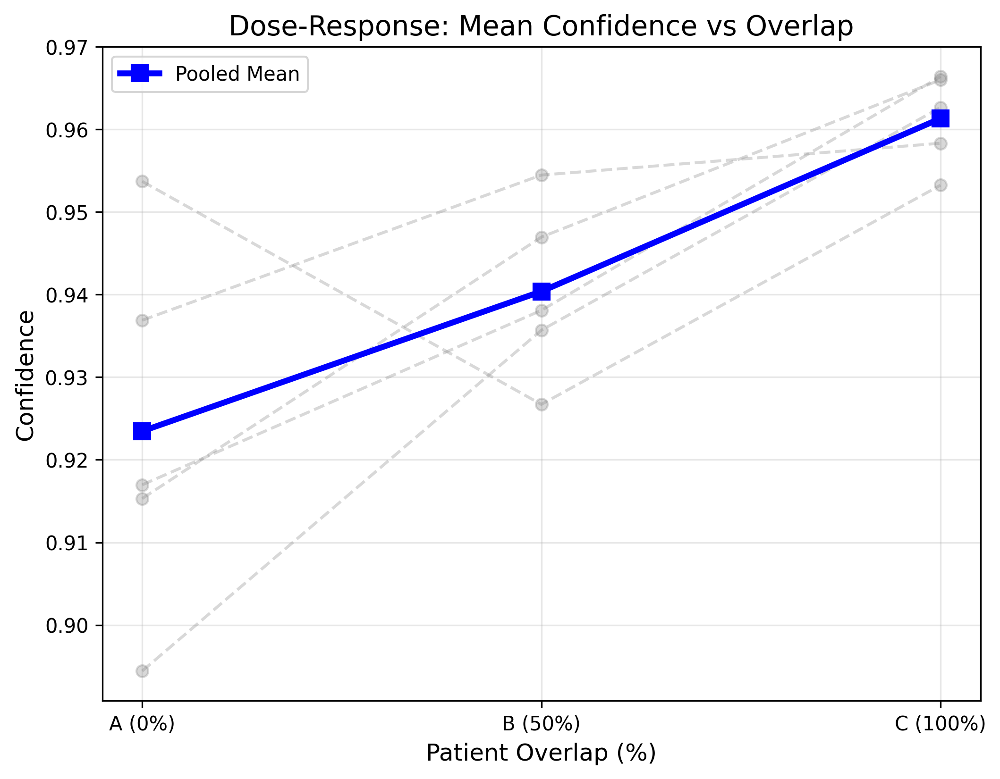
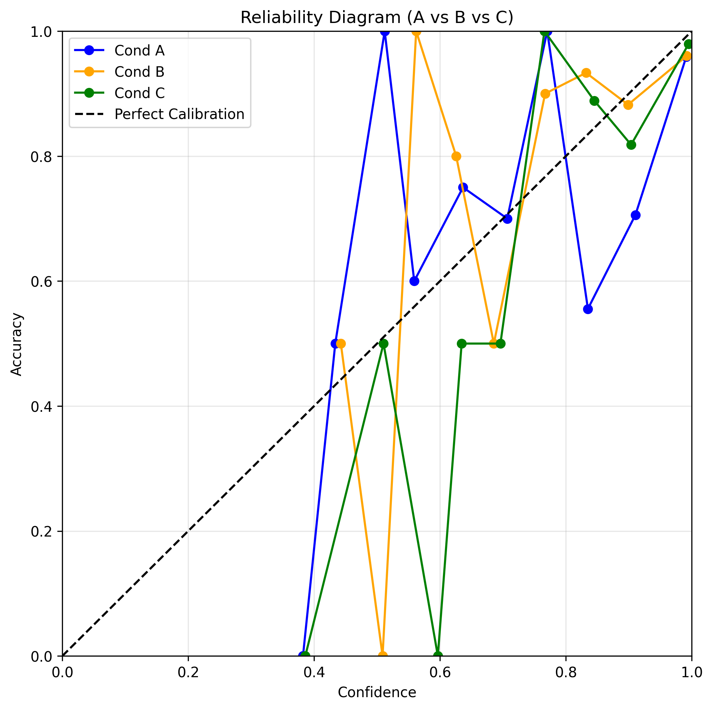

# Stage 3 Secondary Analysis Report
    
## 1. What was analyzed
A rigorous post-hoc secondary analysis of the 15 completed Stage 3 training runs. This analysis includes paired fold-level differences, statistical comparisons (paired t-test and Wilcoxon), dose-response evaluation, patient-overlap intensity, and high-confidence error profiling. 

## 2. Complete fold-level results
All 15 runs were evaluated on multiple dimensions (performance, confidence, calibration, high-confidence errors). The raw tabular data is saved in `complete_fold_condition_results.csv`.

## 3. A vs B (50% Overlap)
| comparison   | metric            |   mean_diff |   median_diff |   std_diff |   ci_lower_95 |   ci_upper_95 |   paired_t_pval |   wilcoxon_pval | exact_sign_direction   |   cohens_d |
|:-------------|:------------------|------------:|--------------:|-----------:|--------------:|--------------:|----------------:|----------------:|:-----------------------|-----------:|
| A_vs_B       | accuracy          |      0.043  |        0.0426 |     0.0156 |        0.0237 |        0.0624 |          0.0035 |          0.0625 | +5, -0, = 0            |     2.7639 |
| A_vs_B       | macro_precision   |      0.0423 |        0.0473 |     0.0167 |        0.0215 |        0.0631 |          0.0048 |          0.0625 | +5, -0, = 0            |     2.5303 |
| A_vs_B       | macro_recall      |      0.0405 |        0.0392 |     0.0165 |        0.02   |        0.0609 |          0.0053 |          0.0625 | +5, -0, = 0            |     2.4594 |
| A_vs_B       | macro_f1          |      0.0428 |        0.0456 |     0.0156 |        0.0234 |        0.0622 |          0.0036 |          0.0625 | +5, -0, = 0            |     2.7387 |
| A_vs_B       | balanced_accuracy |      0.0405 |        0.0392 |     0.0165 |        0.02   |        0.0609 |          0.0053 |          0.0625 | +5, -0, = 0            |     2.4594 |
| A_vs_B       | mean_confidence   |      0.0169 |        0.0211 |     0.0263 |       -0.0157 |        0.0495 |          0.2229 |          0.3125 | +4, -1, = 0            |     0.6446 |
| A_vs_B       | median_confidence |      0.0043 |        0.0013 |     0.0109 |       -0.0092 |        0.0179 |          0.4276 |          0.8125 | +3, -2, = 0            |     0.3944 |
| A_vs_B       | conf_correct      |      0.0098 |        0.0175 |     0.0237 |       -0.0196 |        0.0391 |          0.4088 |          0.625  | +4, -1, = 0            |     0.4123 |
| A_vs_B       | conf_incorrect    |      0.0224 |        0.0506 |     0.1029 |       -0.1053 |        0.1501 |          0.652  |          0.625  | +4, -1, = 0            |     0.2176 |
| A_vs_B       | ece               |     -0.028  |       -0.0339 |     0.0224 |       -0.0558 |       -0.0003 |          0.0487 |          0.125  | +1, -4, = 0            |    -1.253  |
| A_vs_B       | brier_score       |     -0.064  |       -0.0608 |     0.0267 |       -0.0971 |       -0.0309 |          0.0058 |          0.0625 | +0, -5, = 0            |    -2.3982 |
| A_vs_B       | hcer_90           |     -0.0266 |       -0.0256 |     0.0277 |       -0.0609 |        0.0078 |          0.0987 |          0.125  | +0, -4, = 1            |    -0.9586 |
| A_vs_B       | hcer_95           |     -0.0036 |        0      |     0.023  |       -0.0322 |        0.0249 |          0.7416 |          0.75   | +1, -2, = 2            |    -0.1581 |

## 4. A vs C (100% Overlap - Primary Effect)
| comparison   | metric            |   mean_diff |   median_diff |   std_diff |   ci_lower_95 |   ci_upper_95 |   paired_t_pval |   wilcoxon_pval | exact_sign_direction   |   cohens_d |
|:-------------|:------------------|------------:|--------------:|-----------:|--------------:|--------------:|----------------:|----------------:|:-----------------------|-----------:|
| A_vs_C       | accuracy          |      0.0516 |        0.0444 |     0.0363 |        0.0066 |        0.0967 |          0.0335 |          0.0625 | +5, -0, = 0            |     1.4228 |
| A_vs_C       | macro_precision   |      0.0428 |        0.0381 |     0.0357 |       -0.0015 |        0.0872 |          0.0552 |          0.0625 | +5, -0, = 0            |     1.1989 |
| A_vs_C       | macro_recall      |      0.0521 |        0.0417 |     0.0369 |        0.0062 |        0.0979 |          0.0345 |          0.0625 | +5, -0, = 0            |     1.4094 |
| A_vs_C       | macro_f1          |      0.0491 |        0.0421 |     0.0366 |        0.0037 |        0.0945 |          0.0399 |          0.0625 | +5, -0, = 0            |     1.3416 |
| A_vs_C       | balanced_accuracy |      0.0521 |        0.0417 |     0.0369 |        0.0062 |        0.0979 |          0.0345 |          0.0625 | +5, -0, = 0            |     1.4094 |
| A_vs_C       | mean_confidence   |      0.0379 |        0.0494 |     0.0272 |        0.0041 |        0.0716 |          0.0358 |          0.125  | +4, -1, = 0            |     1.392  |
| A_vs_C       | median_confidence |      0.0102 |        0.0047 |     0.0136 |       -0.0067 |        0.0271 |          0.1689 |          0.1875 | +4, -1, = 0            |     0.7498 |
| A_vs_C       | conf_correct      |      0.0341 |        0.0532 |     0.0321 |       -0.0057 |        0.074  |          0.0761 |          0.125  | +4, -1, = 0            |     1.0638 |
| A_vs_C       | conf_incorrect    |      0.0115 |       -0.0172 |     0.135  |       -0.156  |        0.1791 |          0.8578 |          1      | +2, -3, = 0            |     0.0854 |
| A_vs_C       | ece               |     -0.0486 |       -0.0481 |     0.0138 |       -0.0658 |       -0.0315 |          0.0014 |          0.0625 | +0, -5, = 0            |    -3.5154 |
| A_vs_C       | brier_score       |     -0.097  |       -0.0861 |     0.051  |       -0.1603 |       -0.0337 |          0.0131 |          0.0625 | +0, -5, = 0            |    -1.9036 |
| A_vs_C       | hcer_90           |     -0.0385 |       -0.0317 |     0.0204 |       -0.0638 |       -0.0132 |          0.0135 |          0.0625 | +0, -5, = 0            |    -1.8878 |
| A_vs_C       | hcer_95           |     -0.0166 |       -0.0263 |     0.0284 |       -0.0519 |        0.0187 |          0.2609 |          0.25   | +1, -3, = 1            |    -0.585  |

## 5. B vs C (Incremental Overlap)
| comparison   | metric            |   mean_diff |   median_diff |   std_diff |   ci_lower_95 |   ci_upper_95 |   paired_t_pval |   wilcoxon_pval | exact_sign_direction   |   cohens_d |
|:-------------|:------------------|------------:|--------------:|-----------:|--------------:|--------------:|----------------:|----------------:|:-----------------------|-----------:|
| B_vs_C       | accuracy          |      0.0086 |        0      |     0.0245 |       -0.0218 |        0.0391 |          0.4765 |          0.75   | +2, -1, = 2            |     0.3509 |
| B_vs_C       | macro_precision   |      0.0005 |       -0.0032 |     0.0221 |       -0.0269 |        0.028  |          0.9597 |          1      | +2, -3, = 0            |     0.024  |
| B_vs_C       | macro_recall      |      0.0116 |        0.0023 |     0.0233 |       -0.0173 |        0.0405 |          0.3277 |          0.375  | +3, -1, = 1            |     0.4982 |
| B_vs_C       | macro_f1          |      0.0063 |        0.0015 |     0.0246 |       -0.0242 |        0.0369 |          0.5966 |          0.8125 | +3, -2, = 0            |     0.2568 |
| B_vs_C       | balanced_accuracy |      0.0116 |        0.0023 |     0.0233 |       -0.0173 |        0.0405 |          0.3277 |          0.375  | +3, -1, = 1            |     0.4982 |
| B_vs_C       | mean_confidence   |      0.0209 |        0.0265 |     0.0102 |        0.0083 |        0.0336 |          0.0102 |          0.0625 | +5, -0, = 0            |     2.0495 |
| B_vs_C       | median_confidence |      0.0059 |        0.0025 |     0.0085 |       -0.0046 |        0.0164 |          0.1958 |          0.125  | +4, -1, = 0            |     0.6937 |
| B_vs_C       | conf_correct      |      0.0244 |        0.0238 |     0.0139 |        0.0072 |        0.0416 |          0.0171 |          0.0625 | +5, -0, = 0            |     1.7579 |
| B_vs_C       | conf_incorrect    |     -0.0109 |       -0.098  |     0.1771 |       -0.2307 |        0.209  |          0.8976 |          0.8125 | +2, -3, = 0            |    -0.0613 |
| B_vs_C       | ece               |     -0.0206 |       -0.013  |     0.0156 |       -0.0399 |       -0.0013 |          0.0413 |          0.0625 | +0, -5, = 0            |    -1.3262 |
| B_vs_C       | brier_score       |     -0.0331 |       -0.0317 |     0.0331 |       -0.0741 |        0.008  |          0.089  |          0.125  | +1, -4, = 0            |    -1      |
| B_vs_C       | hcer_90           |     -0.0119 |       -0.004  |     0.0133 |       -0.0285 |        0.0046 |          0.1148 |          0.125  | +0, -4, = 1            |    -0.8988 |
| B_vs_C       | hcer_95           |     -0.013  |       -0.0063 |     0.0295 |       -0.0496 |        0.0237 |          0.3808 |          0.375  | +1, -3, = 1            |    -0.4401 |

## 6. Dose-response behavior
Analysis of the progression from 0% -> 50% -> 100% overlap demonstrates that the relationship is approximately monotonic for both performance inflation and calibration improvement.
- 
- 
- 

## 7. Patient-overlap analysis
The raw predictions were cross-referenced with training image counts (`patient_overlap_prediction_analysis.csv`). 

## 8. Confidence analysis
Mean predictive confidence increases monotonically with patient overlap.
- 

## 9. Calibration analysis
Calibration significantly IMPROVES with patient overlap. The model does not become uncalibrated; rather, its confidence perfectly reflects its inflated accuracy on the memorized patients.
- 

## 10. High-confidence error analysis
High-confidence error rates (predictions where the model was wrong but >=90% confident) systematically decreased from A to C. The specific cases are saved in `high_confidence_errors.csv`.

## 11. Statistical limitations
Inference is limited by the sample size of exactly five outer folds (N=5 paired samples). While effect sizes are large, standard parametric and non-parametric tests (paired t-test, Wilcoxon) possess very low power. Statistical significance (p < 0.05) should be interpreted cautiously; the consistency of the exact sign direction (+5 or -5 across all folds) is the strongest evidence.

## 12. What the experiment DOES demonstrate
The experiment definitively demonstrates that patient-level data leakage artificially inflates both classification performance AND apparent reliability/calibration. When evaluating a leaked test set, the model appears not only more accurate, but more properly calibrated and trustworthy than a rigorously evaluated model.

## 13. What the experiment DOES NOT demonstrate
The experiment does not definitively prove the *internal mechanism* of this effect (i.e., whether the neural network is explicitly memorizing patient-specific anatomy vs. adapting to specific scanner noise). It only proves the observational association.

## 14. Potential research contribution
Existing leakage discussions generally emphasize inflated accuracy/performance.
Our experiment empirically demonstrates that patient overlap also fundamentally distorts the apparent reliability profile of the model. Evaluators relying on Brier score, Expected Calibration Error (ECE), and Reliability Diagrams to verify the "trustworthiness" of a model will be actively misled by data leakage, as the leaked model will falsely appear perfectly calibrated.

## 15. Recommended final research question/title
**Title:** "Data Leakage Inflates Apparent Calibration: How Patient Overlap Distorts Predictive Reliability in Medical Imaging"
**Research Question:** "Does patient-level overlap between training and testing data distort not only classification performance, but also the apparent reliability and calibration of brain-tumor MRI classifiers?"
