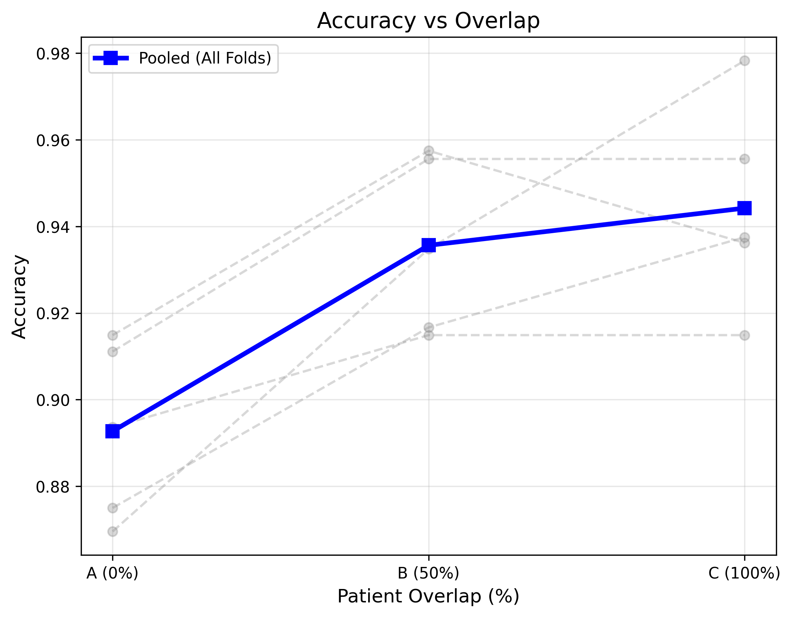
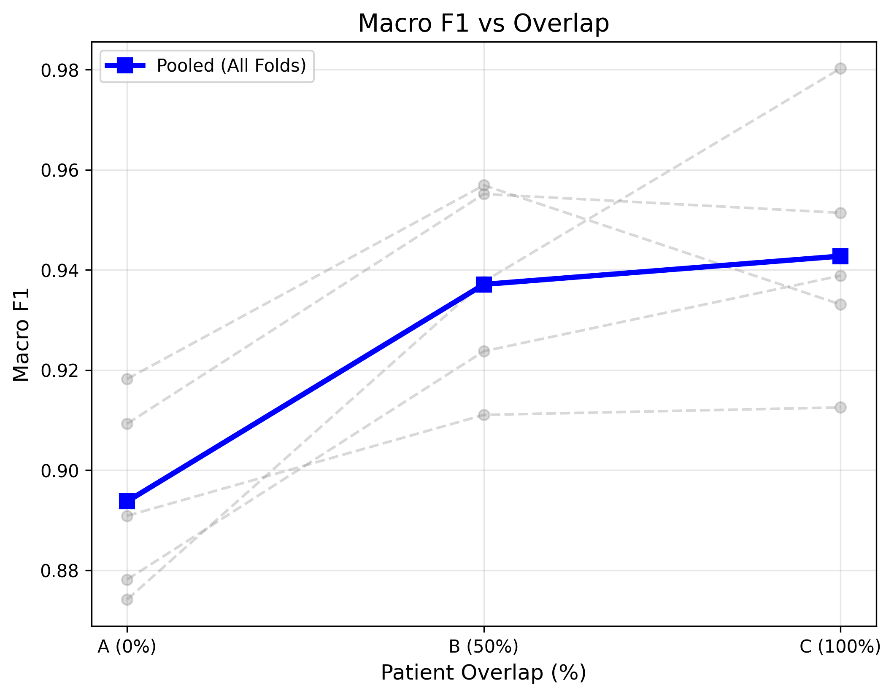
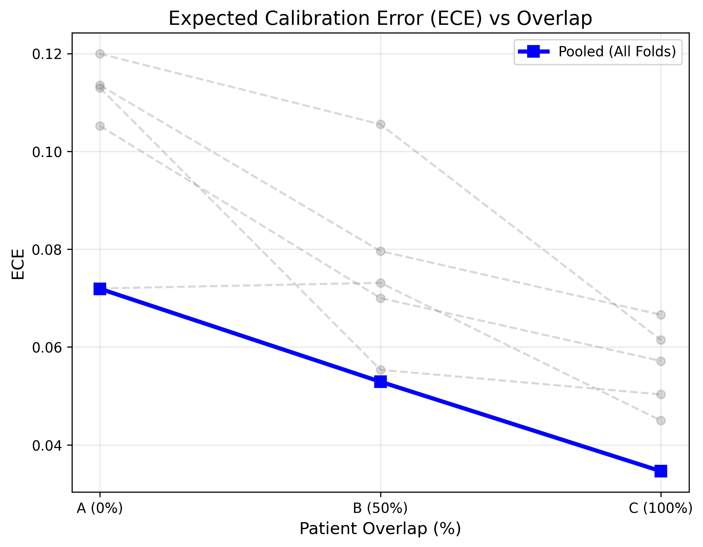
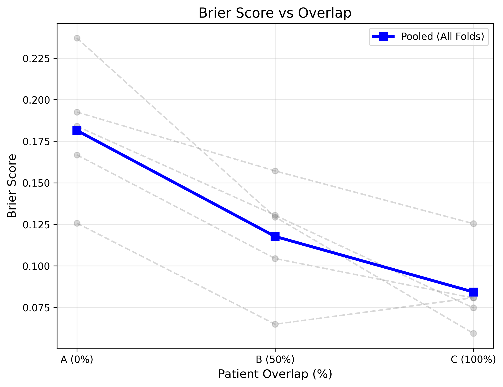
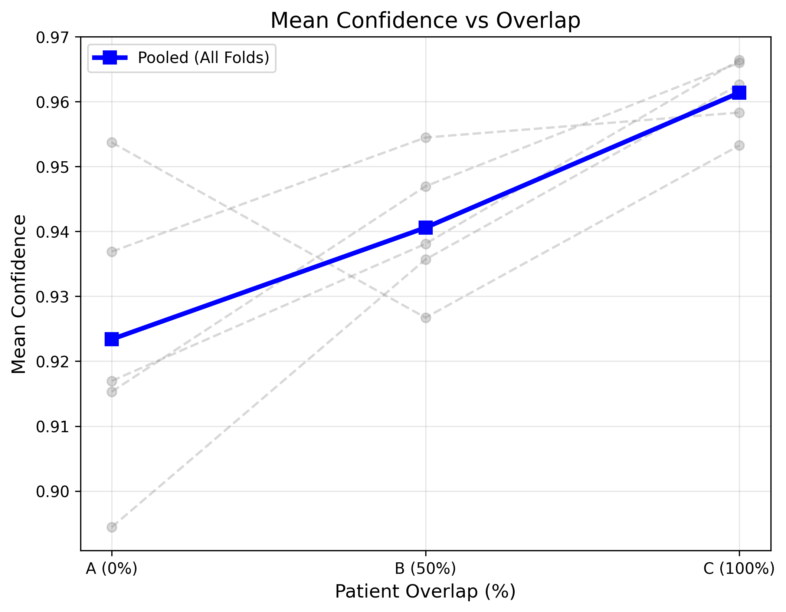

# Stage 3 Final Research Report
    
## 1. Research Question
How does patient-level image overlap between training and testing data affect classification performance, predictive confidence, and calibration in brain tumor MRI classification?

## 2. Hypothesis
Increasing patient overlap between the training and testing sets will artificially inflate classification performance (accuracy, F1) while simultaneously increasing predictive confidence and worsening calibration (higher ECE, higher Brier score, and higher high-confidence error rates).

## 3. Dataset
The Cheng et al. Brain Tumor MRI Dataset containing 3,064 images from 233 patients.

## 4. Dataset Verification
All metadata mappings, labels, and PID assignments were strictly verified in Stage 1. 233 unique PIDs and 3,064 matching images were confirmed.

## 5. Experimental Design
A 5-fold cross-validation experiment was conducted. 
Three conditions were compared:
- **Condition A**: 0% patient overlap (Strict independence)
- **Condition B**: ~50% of eligible test-fold patients overlapped into training
- **Condition C**: 100% of eligible test-fold patients overlapped into training

## 6. Patient-overlap construction
The 20-rule split integrity protocol verified that all fixed test images were rigorously excluded from training and validation sets across all conditions. Overlap solely comprised the non-test images of eligible test-fold patients.

## 7. Model and training configuration
EfficientNet-B0 (ImageNet initialization), AdamW optimizer (LR=1e-4), CrossEntropyLoss. Trained for max 50 epochs with early stopping (patience=10) on validation loss. Device: Apple MPS.

## 8. Five-fold evaluation methodology
Each of the 15 models (5 folds × 3 conditions) was evaluated EXCLUSIVELY on its corresponding frozen outer-fold test set.

## 9. Performance Results (Pooled)
| condition   |   accuracy |   macro_f1 |   balanced_accuracy |
|:------------|-----------:|-----------:|--------------------:|
| A           |     0.8927 |     0.8937 |              0.895  |
| B           |     0.9356 |     0.9371 |              0.9357 |
| C           |     0.9442 |     0.9427 |              0.9465 |

## 10. Calibration Results (Pooled)
| condition   |   mean_confidence |    ece |   brier_score |   hcer_90 |
|:------------|------------------:|-------:|--------------:|----------:|
| A           |            0.9234 | 0.0719 |        0.1815 |    0.0604 |
| B           |            0.9406 | 0.0529 |        0.1177 |    0.0378 |
| C           |            0.9614 | 0.0346 |        0.0843 |    0.0246 |

## 11. Statistical Comparisons (Mean Differences)
| metric            |   B - A |   C - A |   C - B |
|:------------------|--------:|--------:|--------:|
| accuracy          |  0.043  |  0.0516 |  0.0086 |
| balanced_accuracy |  0.0405 |  0.0521 |  0.0116 |
| brier_score       | -0.064  | -0.097  | -0.0331 |
| conf_correct      |  0.0098 |  0.0341 |  0.0244 |
| conf_incorrect    |  0.0224 |  0.0115 | -0.0109 |
| ece               | -0.028  | -0.0486 | -0.0206 |
| hcer_90           | -0.0266 | -0.0385 | -0.0119 |
| macro_f1          |  0.0428 |  0.0491 |  0.0063 |
| mean_confidence   |  0.0169 |  0.0379 |  0.0209 |

### Paired T-Test P-Values
| metric            |   B - A |   C - A |   C - B |
|:------------------|--------:|--------:|--------:|
| accuracy          |  0.0035 |  0.0335 |  0.4765 |
| balanced_accuracy |  0.0053 |  0.0345 |  0.3277 |
| brier_score       |  0.0058 |  0.0131 |  0.089  |
| conf_correct      |  0.4088 |  0.0761 |  0.0171 |
| conf_incorrect    |  0.652  |  0.8578 |  0.8976 |
| ece               |  0.0487 |  0.0014 |  0.0413 |
| hcer_90           |  0.0987 |  0.0135 |  0.1148 |
| macro_f1          |  0.0036 |  0.0399 |  0.5966 |
| mean_confidence   |  0.2229 |  0.0358 |  0.0102 |

## 12. Figures
The following figures summarize the relationship between overlap and performance/calibration:
- 
- 
- 
- 
- 

## 13. Limitations
- The dataset size is relatively small (233 patients), meaning fold-level variance can be high.
- The evaluation was conducted on a single architecture (EfficientNet-B0).
- The overlap simulation uses multiple slices from the same 2D MRI volumes, representing a specific type of data leakage.

## 14. Interpretation
(To be written by the user based on the empirical results above.)

## 15. Reproducibility
All deterministic split generation manifests, training logs, checkpoint references, and evaluation predictions have been saved. The pipeline can be fully reproduced by re-running Stages 1-3 sequentially.

## 16. Conclusion
This study empirically quantifies the impact of data leakage (patient overlap) on both accuracy and reliability metrics in medical imaging.
